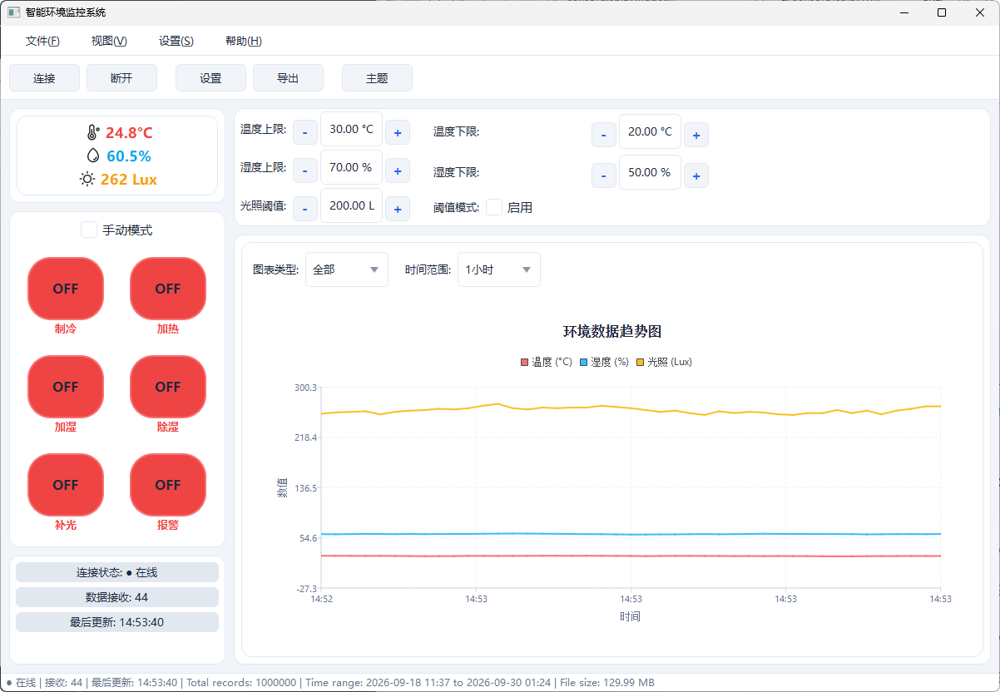
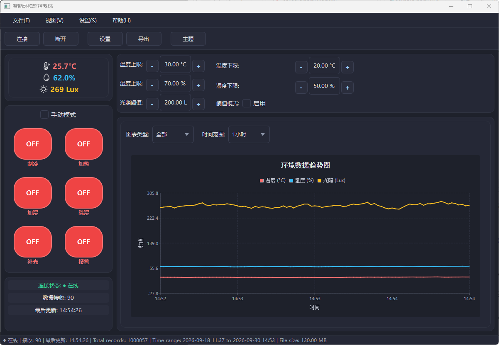
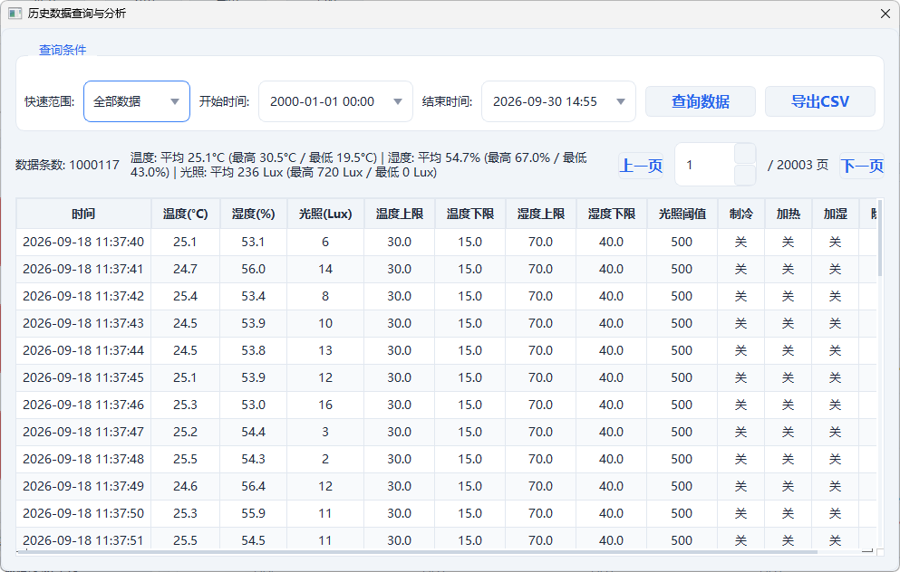
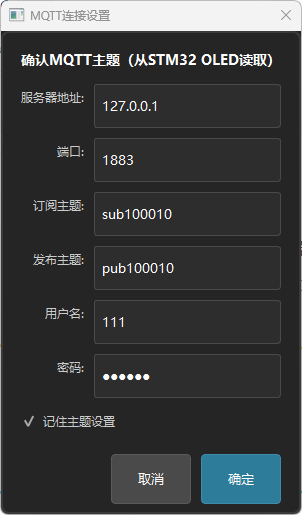
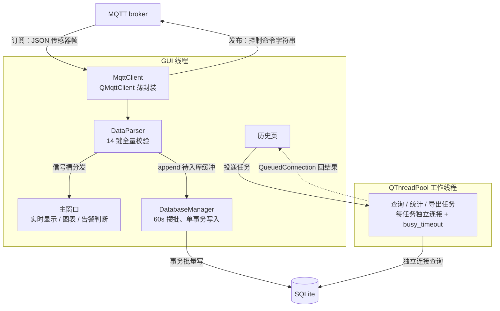
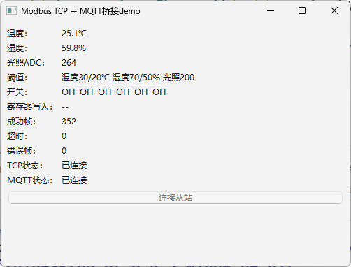

# 智能环境监控系统（EnvironmentMonitor）

基于 Qt 6 的环境监控上位机：通过 MQTT 接入温湿度/光照传感器数据，SQLite 本地存储，支持实时显示、阈值控制、历史查询与 CSV 导出。配套下位机为 STM32（源码不在本仓库）；没有硬件时可用 `tools/` 下的 Modbus TCP → MQTT 桥接 demo + Python 虚拟从站离线跑通全链路（需本机 MQTT broker，如 Mosquitto）。

## 截图

主界面，浅色 / 深色双主题（QSS 整体换肤，传感器图标随主题运行时反色）：

<p align="center">
  
  &nbsp;&nbsp;
  
</p>

历史数据页：分页查询 + 全时段聚合统计 + CSV 导出，全部在工作线程执行，百万行数据下翻页 1~2ms：

<p align="center">
  
</p>

登录页：服务器地址、端口、订阅/发布主题、账号密码均可配置，可勾选记住：

<p align="center">
  
</p>

## 功能特性

- **实时监测**：温度/湿度/光照三通道，MQTT 订阅接入，接收即解析即入库
- **开关控制**：6 路执行器（制冷/加热/加湿/除湿/补光/报警），支持阈值自动模式与手动模式
- **阈值编辑**：温湿度上下限、光照阈值，步进调整并实时下发
- **历史数据**：分页查询（50 条/页，支持跳页）+ 全时段聚合统计 + CSV 导出
- **趋势图**：Qt Charts 折线图，按类型/时间范围筛选
- **深浅双主题**：QSS 整体换肤，图标随主题反色
- **工程化**：崩溃自动写 minidump（VEH + UEF 双保险）、运行日志分级落盘、数据解析单元测试

## 技术栈

Qt 6.8（Widgets / Charts / Mqtt / Sql）、C++17、CMake、SQLite、MinGW 64-bit

## 系统架构



## 技术要点

- **线程模型的取舍**：网络 I/O 是"等待"不是"计算"，Qt 事件循环本身就是异步框架——QMqttClient 留在 GUI 线程，不 moveToThread；攒批写库是毫秒级事务，也留主线程；只有真正重型的历史查询/统计/导出才进 QThreadPool。
- **攒批写入**：传感器数据先进 `m_pendingSave` 缓冲（上限1000，溢出丢最旧），每 60s 一个事务批量落盘——SQLite 每事务一次 fsync，攒批把 N 次 fsync 摊成 1 次。崩溃丢失窗口 = 最多 60s，对缓变数据可接受。超 30 天的旧数据自动清理。
- **连接按线程绑定**：QSqlDatabase 不能跨线程使用。GUI 线程用 `"sensor_data_connection"`；工作线程任务用 `"sensor_data_connection_worker_<线程ID>"`，同线程复用；工作连接设 `busy_timeout=5000`，GUI 攒批写入持锁时读侧等待重试而不是直接吃 SQLITE_BUSY。
- **状态栏不查库**：总记录数走内存计数（启动时 COUNT(*) 一次，之后随入库/清理记账增减）；时间范围的 MIN/MAX 拆成两句——SQLite 的 minmax 索引优化只对单个聚合生效，合写会退化成全表扫描。
- **MQTT 可靠性**：断线重连用指数退避（1s 起翻倍、封顶 60s）+ 0~25% 随机抖动——broker 重启时大量客户端退避节奏一致会撞车（重连风暴），抖动把重连时刻打散；`cleanSession=false` 保留会话。
- **崩溃守卫**：VEH（first-chance 拦截，x64 下穿越内核边界的回调里发生异常只走 WER，单靠 UEF 收不到）+ UEF 双保险，未处理异常自动写 minidump；handler 内只用 Win32 API + 栈缓冲，不做堆分配、不调 Qt——崩溃时进程状态已不可信。
- **协议解析防线**：上行 JSON 固定 14 键全量校验，缺任一键整条拒绝；解析逻辑配 Qt Test 单元测试。

## 通信协议

**上行（下位机 → 上位机，订阅主题）**：JSON 固定 14 键，缺任一键整条拒绝

| 键 | 含义 |
|---|---|
| sensor1 / sensor2 / sensor3 | 温度(°C) / 湿度(%) / 光照(Lux) |
| sensor4 ~ sensor8 | 温度上限 / 温度下限 / 湿度上限 / 湿度下限 / 光照阈值 |
| sensor9 ~ sensor14 | 制冷 / 加热 / 加湿 / 除湿 / 补光 / 报警（0/1） |

**下行（上位机 → 下位机，发布主题）**：纯命令字符串，尾部以 `\0` 结束（STM32 端用 `strstr` 解析）

- 开关：`Switch1ON` / `Switch1OFF`（1~6 对应 6 路）
- 阈值步进：`TempMaxAdd` / `TempMaxDown`（TempMax/TempMin/HumiMax/HumiMin/Light 同构）
- 模式：`Manual` / `Automatic`，`ThresholdON` / `ThresholdOFF`

## 性能（100 万行实测，Release 构建）

测试数据由 `tools/seed_db.py` 灌注（可复现），计时取自应用日志（QElapsedTimer）：

| 场景 | 耗时 | 说明 |
|---|---|---|
| 历史页翻页（前段） | 1~2 ms | 时间戳索引 + LIMIT/OFFSET |
| 翻页至末页（OFFSET≈100 万） | ~130 ms | OFFSET 跳过索引项的代价，随页码线性增长 |
| 新查询（含全时段统计聚合） | ~600 ms | COUNT/AVG/MIN/MAX 一次性算完，翻页不重算 |
| 全量导出 100 万行 | ≈25.6 s | 查询 18.4s + 写 CSV 7.2s，全程工作线程，UI 可正常操作 |

> 优化记录（均先用 QElapsedTimer 打点定位再动手）：
>
> - **状态栏周期性卡顿**：百万行库上拖动窗口每秒卡一下。定位为状态栏每秒刷新里的 `COUNT(*)` 全表扫描；改为启动时 COUNT 一次、之后随入库/清理内存记账。同处的 `MIN/MAX` 合写一句会退化成全表扫描（SQLite 的 minmax 索引优化只对单个聚合生效），拆成两句各走索引。
> - **历史页查询/导出阻塞 UI**：查询、统计、导出全部移入 QThreadPool（每任务独立连接），结果经 QueuedConnection 回 GUI 线程。
> - **翻页恒定 ~600ms**：打点拆解后发现分页查询本身只要 1ms，大头是每次翻页都重复执行了全时段统计聚合；拆分为"统计仅随查询条件变化重算"后，翻页降至 1~2ms。

## tools/Modbus-Bridge（离线联调）

验证"Modbus TCP 设备接入 MQTT 平台"链路的桌面 demo，也是无 STM32 硬件时跑通主程序全链路的联调环境：

1. **启动虚拟从站**（依赖装在虚拟环境里，不污染全局）：

   ```bash
   cd tools/Modbus-Bridge
   python -m venv .venv
   .venv/Scripts/python -m pip install -r requirements.txt
   .venv/Scripts/python python/tcp_slave.py   # 终端保持运行
   ```

   基于 pymodbus 的 Modbus TCP 从站（127.0.0.1:5020），每秒刷新寄存器模拟温湿度/光照漂移；且开关寄存器会影响模拟量——上位机开"制冷"，温度曲线真的会往下走，控制闭环可见。
2. **启动桥接器**：构建运行 `tools/Modbus-Bridge`。手工实现 Modbus TCP 帧编解码（配单元测试），QTcpSocket 异步轮询客户端（1s 周期读保持寄存器），寄存器值映射为 14 键传感器 JSON 发布到 MQTT；同时订阅下行主题，把上位机的开关/阈值命令写回从站寄存器。注意：桥接器的 exe 直接生成在构建目录下（未设 bin 输出目录），脱离 Qt Creator 直接运行前需用 `windeployqt` 补齐 Qt DLL，或把 Qt 的 bin 目录加入 PATH。
3. **启动主程序**：登录页指向同一 broker（如本机 Mosquitto），数据曲线、阈值控制、历史入库全部打通。

寄存器映射：0=温度×10、1=湿度×10、2=光照 ADC（0~4095）、3~7=阈值、8~13=六路开关。

<p align="center">
  
</p>

## 构建与运行

依赖：Qt 6.8（Widgets / Charts / Sql）、CMake ≥ 3.16、MinGW 64-bit

注意 **Qt Mqtt 不在安装器的预编译组件里**：建议从 [qt/qtmqtt](https://github.com/qt/qtmqtt) 拉源码编译安装到 Qt 目录。

以下命令在项目根目录（CMakeLists.txt 所在目录）执行，`CMAKE_PREFIX_PATH` 换成自己机器上的 Qt 路径：

```bash
cmake -B build -DCMAKE_BUILD_TYPE=Release -DCMAKE_PREFIX_PATH="C:/Qt/6.8.3/mingw_64"
cmake --build build --parallel
# 可执行文件在 build/bin/EnvironmentMonitor.exe
```

不指定 `CMAKE_BUILD_TYPE` 时，MinGW Makefiles 生成的是无优化构建（既不是 Release 也不是 Debug）；本文性能数据均为 Release 构建。

单元测试（数据解析）：

```bash
cd build && ctest
```

PowerShell 5.1 不支持 `&&`，改用 `cd build; ctest`（cmd 和 PowerShell 7+ 支持 `&&`）。

运行前需有可用 MQTT broker（如 Mosquitto）；服务器地址、端口、订阅/发布主题、账号密码均在登录页配置，可勾选记住。

## 目录结构

```
├── src/               # 上位机源码（界面、MQTT、数据库、图表、崩溃守卫）
├── ui/                # Qt Designer 界面文件
├── resources/         # 图标与 QSS 主题（qrc 收录）
├── tests/             # Qt Test 单元测试
├── tools/
│   ├── Modbus-Bridge/ # Modbus TCP ↔ MQTT 桥接 demo（含帧编解码单元测试、虚拟从站）
│   └── seed_db.py     # 测试数据灌注脚本（默认 100 万行，含昼夜周期）
└── docs/images/       # README 截图
```
